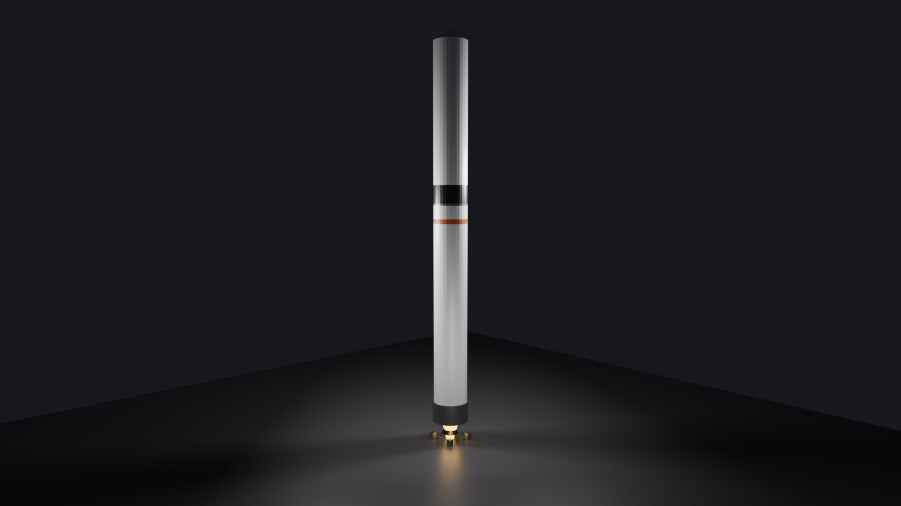
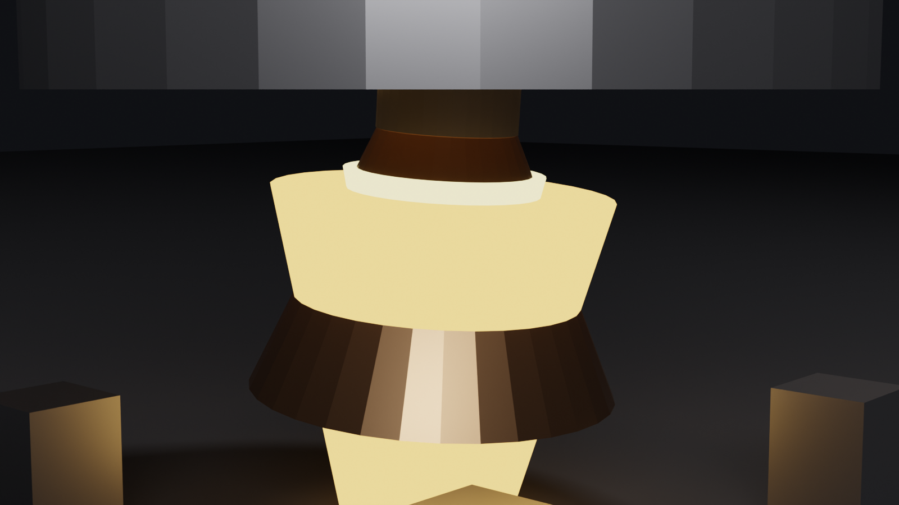
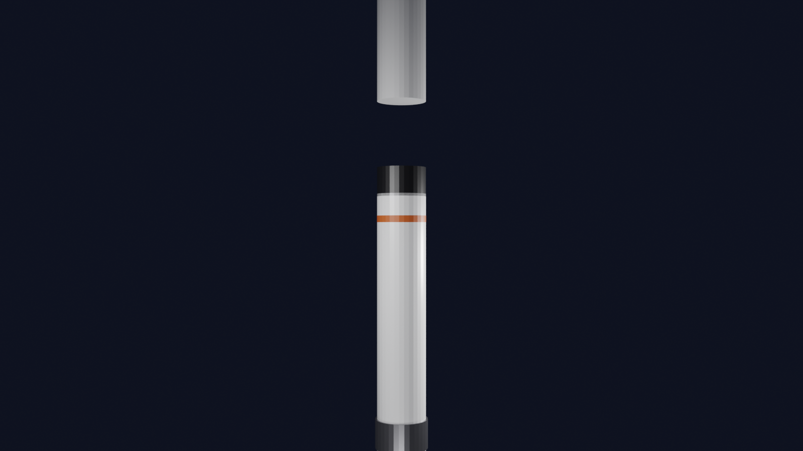
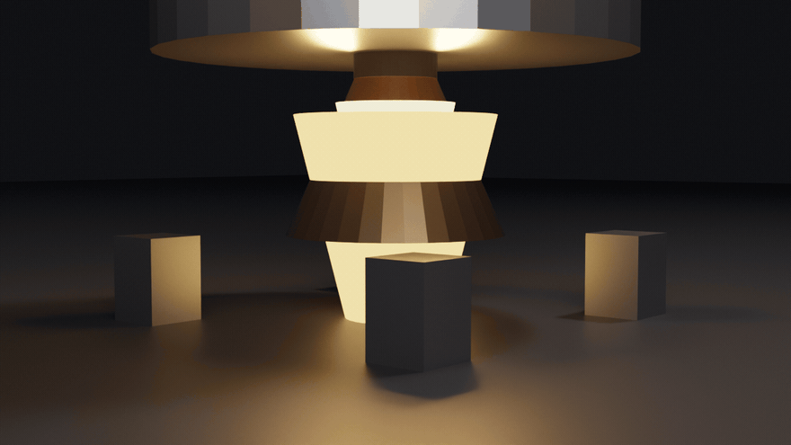

# 🚀 rocket-cinema

**EN:** A **two-stage rocket that actually flies** — no keyframes. A numerical ascent integrator (thrust → mass flow → acceleration → altitude) drives everything, and the Tsiolkovsky gate holds it honest: the integrated Δv of each stage must match the analytic rocket equation **ve·ln(m₀/m₁) to 0.003%**. In Blender: gimbaled engine bell sweeping ±5°, flame cone and light following the pivot, stage separation that really drops the first stage.

**TR:** **Gerçekten uçan** iki kademeli roket — anahtar kare yok. Sayısal yükseliş entegratörü (itki → kütle akısı → ivme → yükseklik) her şeyi sürer ve Tsiolkovsky kapısı dürüstlüğü garantiler: her kademenin entegre Δv'si analitik roket denklemine **%0.003 sapma** ile eşleşmek zorunda. Blender'da: ±5° süpüren gimbal motor, pivota uyan alev konisi, ilk kademesini gerçekten bırakan ayırma.



## 🖼️ Gallery / Galeri

### 🏭 Stüdyo — tam yığın

45 m stack: stage 1, black interstage, stage 2, payload fairing. — *45 m yığın: kademe-1, siyah ara kat, kademe-2, yük zarfı.*

### 🔥 Motor detay — gimbal

Copper bell on its pivot, throat glowing. — *Pivota bağlı bakır çan, parlayan bogaz.*

### 💥 Kademe ayrılması

Stage 1 + interstage released — the mass gate drops exactly the dry mass. — *Kademe-1 + ara kat bırakıldı — kütle kapısı tam kuru kütleyi düşürür.*

### ⚙️ Gimbal animasyonu

*36 frames: the nozzle sweeps ±5°, thrust vector and flame follow the pivot.*

## 🧱 Physics / Fizik

| Piece | Detail |
|---|---|
| 🚀 Stages | K1: 620 kN / ve 2820 m/s · K2: 110 kN / ve 3480 m/s (vakum) |
| ⏱️ Burn | mdot = F/ve → K1 127 s, coast 2 s, K2 202 s |
| 🧮 Tsiolkovsky | Δv = ve·ln(m₀/m₁) — K1: 3152.8, K2: 4228.3 m/s |
| 🎯 Gimbal | nozzle unit vector (sin a, 0, cos a); lateral thrust share = sin a |
| 📈 Ascent | vertical ODE: a = F/m − g₀; apogee 616 km in sim |

## ✅ Verification / Doğrulama

```bash
python3 tests/verify.py
```

- **TWR gate**: liftoff thrust-to-weight = 1.52 > 1
- **Tsiolkovsky gates**: integrated Δv = analytic for both stages (0.003%)
- **Separation gate**: dropped mass = dry mass of stage 1 (4.50 t)
- **Coast gate**: velocity decreases during the 2 s ullage coast
- **Orbit gate**: sim apogee > 100 km (616 km)
- **Gimbal gates**: unit vector + lateral share = sin(a)
- **Determinism gate**

## 🚀 Usage / Kullanım

```bash
blender --background --python rocket_render.py -- --scene scenes/studyo.json
HIZLI=1 blender --background --python rocket_render.py -- --scene scenes/motor_detay.json
blender --background --python rocket_render.py -- --scene scenes/gimbal.json --gif 36 --fps 12
```

**Kardeş projeler:** [`pad-cinema`](https://github.com/efealtiparmakoglu/pad-cinema) bu roketin fırlatma kompleksini, [`orbit-cinema`](https://github.com/efealtiparmakoglu/orbit-cinema) gece fırlatışını inşa eder.

## 🧪 Why / Neden

**TR:** Roket animasyonu kolaydır: yüksel, sallan, parlat. Zor olan, yükselişin bir denklem olmasıdır: itki kütleyi azaltır, azalan kütle ivmeyi büyütür, büyüyen ivme yüksekliği yazar — ve entegre edilen hız, Tsiolkovsky'nin kapanmış logaritmasından sapmaz. Bu repo makinenin denklemini kapılarla korur; render, kanıtın üstündeki mühürdür.

## 📄 License

MIT
